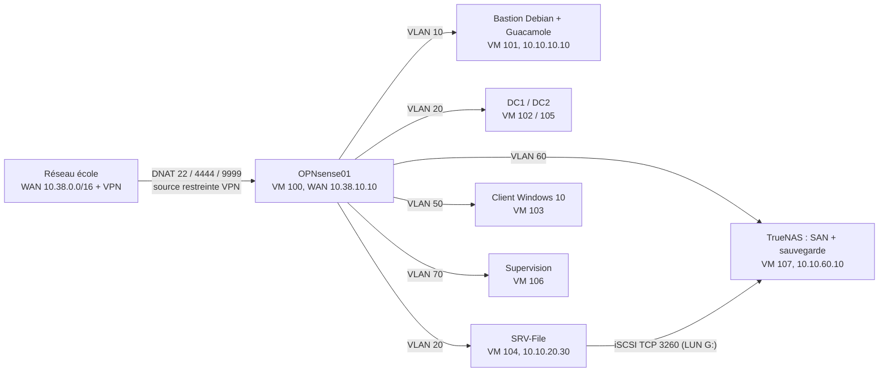
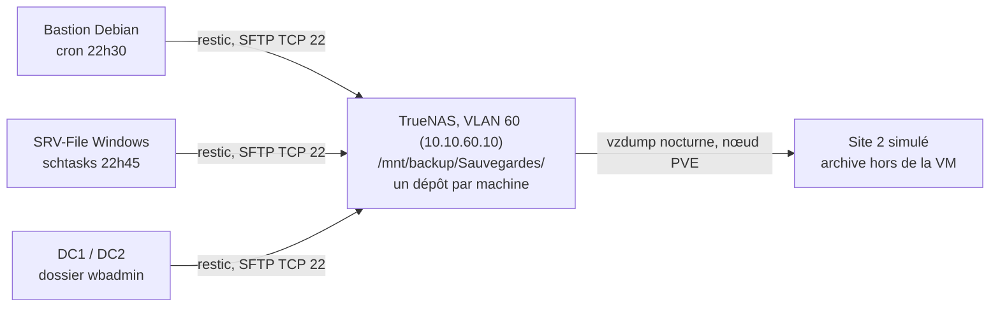
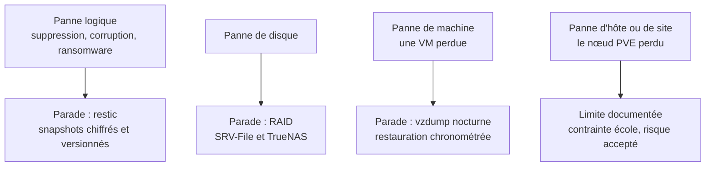


# **Infrastructures avancées 1 - LAB NOVATECH**

________________________________________

## 1. Présentation
 

- **Le scénario**

Novatech est une PME de 250 collaborateurs sur 2 sites : ERP, serveur de fichiers, messagerie et site web.

- **La mission**

Concevoir, déployer et gouverner son infrastructure on-premise ; chaque atelier alimente un dossier d’architecture unique.

- **Les VLAN**

Segmentation du réseau en fonction des usages, des services et des criticités.

___


> **Schéma d'architecture cible : voir "schema-infra-cible.png"**


________________________


## 2. Plan d'adressage réseau - NovaTech.lan

 **Synthèse par VLAN**

| ID VLAN | Nom du VLAN | Rôle / Usage | Sous-réseau (CIDR) | Passerelle (OPNsense) | Plage DHCP (Optionnel) |
| :--- | :--- | :--- | :--- | :--- | :--- |
| **10** | Management | Administration, Ansible, Git | `10.10.10.0/24` | `10.10.10.254` | Non (IP Fixes) |
| **20** | Serveurs | Applications, Windows Server, Docker, k3s, Web | `10.10.20.0/24` | `10.10.20.254` | Non (IP Fixes) |
| **30** | DMZ | Services exposés (Web public) | `10.10.30.0/24` | `10.10.30.254` | Non (IP Fixes) |
| **40** | Stockage | NAS, SAN (iSCSI), NVMe/TCP | `10.10.40.0/24` | `10.10.40.254` | Non (IP Fixes) |
| **50** | Users | Postes clients et Tests | `10.10.50.0/24` | `10.10.50.254` | DHCP `10.0.50.10 - .210` |
| **60** | Sauvegarde | Truenas + raid 1 + icsci/backup/share | `10.10.60.0/24` | `10.10.60.254` | Non (IP Fixes) |
| **70** | Sécurité | Zabbix | `10.10.70.0/24` | `10.10.70.254` | Non (IP Fixes) |


___

## 3. Matrice de flux


**Principe : deny all par défaut.** Chaque interface ne possède que les règles listées ci-dessous, évaluées dans l'ordre (première correspondance gagne). Tout le reste est bloqué silencieusement. Le pare-feu est **stateful** : les flux de retour n'ont pas besoin de règles, seules les connexions **initiées** sont déclarées.

### Portes d'entrée (WAN)

| Action | Proto | Source | Destination | Objectif |
| --- | --- | --- | --- | --- |
| pass | TCP | alias `VPN-ecole` | DNAT → 10.10.10.10:8080 (WAN 4444) | Guacamole, porte web des services |


### Interface VLAN10ADMIN

| # | Action | Proto | Source | Destination | Port | Description |
| --- | --- | --- | --- | --- | --- | --- |
| 1 | pass | TCP | VLAN10ADMIN net | This Firewall | `OPNsenseAdmin` | GUI/SSH du pare-feu depuis l'admin |
| 2 | pass | IPv4 * | VLAN10ADMIN net | * | * | L'admin va partout |

La règle 2 est une **permessivité assumée** pour le réseau d'administration (déploiements Ansible prévu, diagnostics, sauvegarde du bastion vers TrueNAS) : documentée comme choix, pas comme angle mort.

### Interface VLAN20SRV

| # | Action | Proto | Source | Destination | Port | Description |
| --- | --- | --- | --- | --- | --- | --- |
| 1 | pass | TCP | VLAN20SRV net | 10.10.60.10/32 | 22 | BKP restic |
| 2 | pass | TCP/UDP | VLAN20SRV net | 10.10.70.10/32 | `PortsSupervision` | flux vers Zabbix |
| 3 | pass | TCP | VLAN20SRV net | 10.10.60.10/32 | 3260 | initiation iSCSI |
| 4 | pass | IPv4 * | VLAN20SRV net | ! 10.10.0.0/16 | * | Internet (updates) |

Deux flux seulement vers l'îlot de sauvegarde (restic :22, iSCSI :3260), cible unique 10.10.60.10. Le `!` de la règle 4 garantit qu'« Internet » ne peut pas être détourné vers un sous-réseau interne.

### Interface VLAN30DMZ

| # | Action | Proto | Source | Destination | Port | Description |
| --- | --- | --- | --- | --- | --- | --- |
| 1 | **BLOCK** | IPv4 * | VLAN30DMZ net | 10.10.0.0/16 | * | DMZ jamais vers l'interne |
| 2 | pass | IPv4 * | VLAN30DMZ net | * | * | Internet uniquement |

Le bloc **en tête** est la protection principale : même une erreur dans une règle suivante ne pourrait pas ouvrir l'interne, la règle 1 gagne toujours. Un serveur DMZ compromis ne peut rien voir du réseau interne.

### Interface VLAN40stockage

**Aucune règle définie.** L'interface est un « îlot noir » : elle n'initie rien et rien n'y entre (deny implicite total, y compris depuis le VLAN serveurs).

### Interface VLAN50users

| # | Action | Proto | Source | Destination | Port | Description |
| --- | --- | --- | --- | --- | --- | --- |
| 1 | pass | UDP | VLAN50users net | VLAN20SRV net | `ADPortsUDP` | Kerberos, DNS, NTP |
| 2 | pass | ICMP | VLAN50users net | VLAN20SRV net | * | ICMP vers DC (locator AD + détection lien lent) |
| 3 | pass | TCP | VLAN50users net | VLAN20SRV net | `ADPortsTCP` | Auth AD + fichiers + DNS |
| 4 | pass | TCP | VLAN50users net | 10.10.60.10/32 | 22 | BKP Restic |
| 5 | pass | IPv4 * | VLAN50users net | ! 10.10.0.0/16 | * | Internet unique |

Un poste utilisateur ne joint **que** les contrôleurs (ports AD explicites), la cible de sauvegarde (restic), et Internet. Aucun accès direct au stockage, à la DMZ, à la supervision ni à l'admin. L'ICMP vers les DC est un besoin fonctionnel AD (DC locator, détection de lien lent pour les GPO), souvent oublié des matrices.

### Interface VLAN60Sauvegarde

| # | Action | Proto | Source | Destination | Port | Description |
| --- | --- | --- | --- | --- | --- | --- |
| 1 | pass | TCP/UDP | VLAN60Sauvegarde net | 10.10.70.10/32 | `PortsSupervision` | Flux Supervision |

Le reste est deny implicite. L'îlot de sauvegarde n'initie que sa propre supervision : les dépôts ne sont accessibles **que** depuis les connexions initiées par les agents (règles VLAN 20/50), jamais l'inverse.

### Interface VLAN70securite

| # | Action | Proto | Source | Destination | Port | Description |
| --- | --- | --- | --- | --- | --- | --- |
| 1 | pass | ICMP | 10.10.70.10/32 | VLAN10ADMIN, VLAN20SRV, VLAN60Sauvegarde, VLAN70securite | * | Autoriser ICMP pour la supervision |
| 2 | pass | TCP/UDP | 10.10.70.10/32 | VLAN10ADMIN, VLAN20SRV, VLAN60Sauvegarde | `PortsSupervision` | Flux supervision vers les VLAN |
| 3 | pass | TCP/UDP | 10.10.70.10/32 | 10.10.1.254/32 | `PortsSupervision` | supervision OPNsense |

Le serveur Zabbix (10.10.70.10) peut **interroger** les agents des VLAN 10/20/60 et le pare-feu lui-même, et rien d'autre. Sens unique : les VLAN supervisés ne peuvent pas atteindre la supervision.

### Alias de ports

| Alias | Contenu | Rôle |
| --- | --- | --- |
| `ADPortsTCP` | TCP 53, 88, 135, 389, 445, 464, 636, 3268, 3269, 49152-65535 | DNS, Kerberos, RPC, LDAP, SMB, LDAPS, catalogue global, RPC dynamique |
| `ADPortsUDP` | UDP 53, 88, 123, 137, 138, 389, 464 | DNS, Kerberos, NTP, NetBIOS |
| `PortsSupervision` | TCP 161, 162, 10050, 10051, 10052, 10053 | Agents Zabbix et trapper/serveur  |
| `OPNsenseAdmin` | TCP 22, 80, 443 | Administration du pare-feu (vérifier la valeur exacte à l'écran) |
| `VPN-ecole` | 172.29.0.0/24 (pool VPN) | Source unique autorisée sur les portes WAN |

___

## 4. Inventaire des équipements et machines virtuelles

> **voir "inventaire-VM.png"**

| Nom de l'équipement | Rôle / Service | Type (VM/LXC/Physique) | VLAN | Adresse IP | Masque | Passerelle | DNS |
| :--- | :--- | :--- | :--- | :--- | :--- | :--- | :--- |
| **OPNsense** | Pare-feu / Routeur / DHCP / NAT | VM | LAN | `10.10.1.254` | - | - | - |  
| **Bastion** | Guacamole / Ansible / Git | VM | 10 | `10.10.10.10` | /24 | `10.10.10.254` | `10.10.20.10` | 
| **Windows-Server** | ADDS / DNS / DHCP / DC / ADCS | VM | 20 | `10.10.20.10` | /24 | `10.10.20.254` | `10.10.20.10` |
| **Windows-Server2** | ADDS / DNS / DC / ADCS | VM | 20 | `10.10.20.20` | /24 | `10.10.20.254` | `10.10.20.20` |
| **SRV-File** | Serveur de fichiers | VM | 20 | `10.10.20.30` | /24 | `10.10.20.254` | `10.10.20.10` | 
| **Poste-client01** | test | VM | 50 | `DHCP` | /24 | `10.10.50.254` | `10.10.20.10` |
| **Supervision** | Supervision | VM | 70 | `10.10.70.10` | /24 | `10.10.70.254` | `10.10.20.10` |
| **Sauvegarde** | Sauvegarde | VM | 60 | `10.10.60.10` | /24 | `10.10.60.254` | `10.10.20.10` |


___

## 5. Choix d'architecture et mise en ouevre des composants du lab NovaTech

> **Schéma de l'infrastructure mise en oeuvre : voir "schema-mise-en-oeuvre.png"**


### 5.1. Contraintes de départ

Le lab vit sur l'hyperviseur Proxmox VE de l'école, accessible uniquement à distance via VPN. 3 contraintes ont façonné tous les choix :

- **MTU 1350** imposé par le réseau de l'école : à configurer de façon persistante sur chaque VM (Windows : `netsh ... mtu=1350 store=persistent`), sinon les gros flux (TLS, images disque) se bloquent en silence. C'est ce qui a fait échouer UrBackup ;
- **Un seul site physique** : le site 2 de NovaTech est simulé (copie `vzdump` hors VM), le tunnel IPsec reste au dossier ;
- **RAM partagée** : allumages échelonnés selon l'atelier.

### 5.2. Architecture retenue



**Principes** :

- **1 VLAN = 1 fonction** : 10 admin, 20 serveurs, 30 DMZ (prête pour A10), 40 stockage, 50 utilisateurs, 60 sauvegarde, 70 supervision ;
- **Deny all par défaut** : chaque flux inter-VLAN est une règle explicite (matrice de flux vérifiable au nmap) ;
- **Îlots sensibles** : les VLAN 60 et 70 n'initient rien vers la production ; seuls les flux utiles y entrent (restic TCP 22, iSCSI 3260) ;
- **Chaîne d'accès distant** : VPN école → DNAT restreints (22 bastion, 4444 Guacamole, 9999 TrueNAS) → cible. Le pare-feu reste la seule porte d'entrée ;
- **Transit 10.10.1.0/24** conservé pour la future synchro CARP/pfsync du second pare-feu.

### 5.3. Choix de solutions et justifications

| Domaine | Choix retenu | Alternative écartée | Justification |
| --- | --- | --- | --- |
| Pare-feu | **OPNsense 25.1** (VM 100) | pfSense | OPNsense est un fork de pfSense, fonctionnellement équivalent pour les fonctions démontrées (VLAN, NAT, CARP) ; pfSense reste la référence dans le dossier |
| Annuaire | **Windows Server 2022, 2 DC** (VM 102/105, VLAN 20) | Samba/LDAP open source | besoin NovaTech réel : GPO, ADCS, joints clients ; licences d'évaluation, sortie assumée du « 100 % open source », flaggée dans le dossier |
| Accès distant | **Bastion SSH (clés ed25519 nominales) + Guacamole** (VM 101) | bureau direct / VPN dédiée | contrainte école ; moindre privilège : un seul chemin d'entrée, comptes individuels, mots de passe SSH désactivés |
| Serveur de fichiers | **SRV-File 2022** (VM 104) : SMB `E:\Shares` + paire RAID dédiée à la sauvegarde AD | NAS centralisé pour tout | séparation des rôles, ACL fines par groupe métier, RAID local pour la couche disque |
| Stockage SAN | **TrueNAS SCALE** (VM 107) : pool RAID, **iSCSI vers SRV-File** (LUN `G:\Sensible`) | LIO/targetcli manuel | interface intégrée, snapshots, partage du rôle sauvegarde (dataset restic) et SAN dans l'îlot VLAN 60 |
| Sauvegarde | **restic via SFTP** → dépôts sur TrueNAS (VLAN 60) + `vzdump` site 2 | UrBackup (testé, échec MTU) | blocs chiffrés robustes au MTU 1350, chiffrement au repos, un dépôt par machine, agent minimal (voir procédure restic) |
| Supervision | **VM dédiée VLAN 70** (VM 106, Ubuntu 24.04) : Zabbix | supervision sur une VM métier | séparation des flux de supervision du trafic métier, îlot supplémentaire |
| Site 2 | **Simulé** : `vzdump` nocturne de la VM TrueNAS sur le nœud | IPsec vers un vrai site | pas de second site disponible |

### 5.4. Inventaire réel des VM (nœud pve-grp2)

| VMID | Nom | OS | RAM / vCPU | Réseau (vmbr1) | Rôle |
| --- | --- | --- | --- | --- | --- |
| 100 | OPNsense01 | OPNsense 25.1 | 2 Go / 1 | vmbr0 (WAN école) + trunk | Pare-feu, routeur inter-VLAN, NAT/DNAT |
| 101 | Bastion | Debian 13 | 4 Go / 1 | tag 10 | Bastion SSH, Ansible, Git `infra-lab`, Guacamole (Docker) |
| 102 | Windows-Server (DC1) | Windows Server 2022 | 4 Go / 2 | tag 20 | ADDS, DNS, DHCP, ADCS (10.10.20.10) |
| 103 | Windows-Client | Windows 10 22H2 | 5 Go / 3 | tag 50 | Poste utilisateur, jointure AD + GPO (VLAN users) |
| 104 | SRV-FILE | Windows Server 2022 | 4 Go / 2 | tag 20 | Partages SMB, paire RAID (sauvegarde AD wbadmin), LUN iSCSI `G:` |
| 105 | Windows-Server02 (DC2) | Windows Server 2022 | 4 Go / 2 | tag 20 | Second DC, redondance AD (10.10.20.20) |
| 106 | Supervision | Ubuntu 24.04 | 2 Go / 1 | tag 70 | Zabbix (serveur + agents à déployer) |
| 107 | SAN | TrueNAS SCALE | 8 Go / 4 | VLAN 60 | Pool RAID (3×100 Go + disques annexes), iSCSI, dépôts restic `/mnt/backup/Sauvegardes/` |


### 5.5 Composants cibles NovaTech → réalisation lab

| Composant cible (dossier) | Réalisation lab | État au 05/11 |
| --- | --- | --- |
| Cluster pare-feu (basculement) | OPNsense01 (VM 100) ; OPNsense02 + CARP (VIP .254) à cloner |  à faire |
| VLAN 10/20/30/40/50 | tags vmbr1 + filtrage inter-VLAN deny all | OK |
| VLAN 60 sauvegarde / 70 supervision | îlots restic-TrueNAS et Zabbix |  |
| DC + AD-CA | 2 DC Windows Server 2022 (VM 102/105) | OK |
| Bastion Guacamole | Bastion Debian (VM 101), Guacamole 1.6.0 (Docker, auth PostgreSQL) | OK |
| srv-file | SRV-File (VM 104), SMB + GPO lecteur réseau | OK |
| SAN/NAS | TrueNAS (VM 107) : pool RAID, iSCSI `G:\Sensible` | OK |
| Sauvegarde redondée + chiffrée | restic SFTP → TrueNAS ; wbadmin AD ; `vzdump` site 2 | OK, DCs à faire |
| Supervision (Zabbix) | VM 106 (VLAN 70) | OK |
| Client du domaine | VM 103 (VLAN 50) | OK |
| Copie cassette | simulée par le `vzdump` hors VM |  |

### 5.6. Traçabilité

Documentation

___

## 6. Procédure de sauvegarde


### 6.1. Principe

**restic** est un outil de sauvegarde open source (licence BSD) : un seul binaire par agent, aucune dépendance. Quatre propriétés fondent le choix :

| Propriété | Détail | Bénéfice constaté au lab |
| --- | --- | --- |
| Chiffrement | AES-256, clé dérivée de la phrase de dépôt (Scrypt) | dépôt illisible sans le secret, même pour l'administrateur TrueNAS |
| Déduplication + compression | découpage en blocs, zstd | incrémental quasi gratuit : 2ᵉ backup à 0 fichier nouveau en 2 s |
| Snapshots | images cohérentes versionnées | retour arrière à tout instant, par fichier ou par machine |
| Intégrité | sommes de contrôle sur toutes les données (`restic check`) | corruption détectable et prouvable |

**Pourquoi pas UrBackup** : testé en premier (sauvegarde par images disque), il a échoué face au MTU 1350 imposé par l'hyperviseur de l'école : les flux d'image massifs se bloquent en silence (handshake TLS à 0 % pendant des minutes). restic envoie de petits blocs chiffrés sur du SSH standard : robuste au MTU, reprise propre, agent minimal (un `.exe` côté Windows, un paquet côté Linux).

### 6.2. Architecture



Points clés :

- **Un dépôt par machine** : un agent compromis ne peut ni lire ni effacer les sauvegardes des autres ;
- **VLAN 60 isolé** (îlot de sauvegarde) : seuls les flux initiés vers TCP 22 (restic SFTP) et TCP 3260 (iSCSI) sont autorisés depuis le VLAN 20 ; le bastion passe par la règle admin ;
- **Site 2** : `vzdump` nocturne de la VM TrueNAS sur le nœud PVE = copie complète du dépôt (données + index), hors de la machine de sauvegarde.

### 6.3. Mise en place 

1. **Serveur TrueNAS** (VM, VLAN 60) : dataset `/mnt/backup/Sauvegardes`, compte `restic` dédié, service SSH actif, **MTU 1350 persistant** (leçon UrBackup).
2. **Authentification** : une clé ed25519 par machine (`ssh-keygen`), publiques collées dans le compte restic TrueNAS. **Pas de mot de passe** : les tâches automatisées doivent passer sans interaction (critère : `ssh restic@10.10.60.10 "echo OK"` sans prompt).
3. **Création des dépôts** (une seule fois par machine) :
   - bastion : `RESTIC_REPOSITORY=sftp:restic@10.10.60.10:/mnt/backup/Sauvegardes/bastion`, phrase dans `/srv/restic.env` (chmod 600) ;
   - Windows : variables posées dans `backup.bat`, phrase dans `C:\restic\pass.txt` ;
   - `restic init` une seule fois par dépôt.
4. 4. **Agents Windows** : `restic.exe` (0.19.1) dans `C:\restic`, scripts avec `-o sftp.command="ssh -i C:/restic/id_ed25519 -o UserKnownHostsFile=C:/restic/known_hosts -o StrictHostKeyChecking=accept-new -o BatchMode=yes restic@10.10.60.10 -s sftp"`. Les options sont obligatoires pour l'automatisation sous SYSTEM : `known_hosts` partagé (indépendant du profil de l'utilisateur), `accept-new` (nouvelle machine acceptée sans question, changement d'empreinte refusé), `BatchMode` (aucune demande possible, échec rapide).
5. **Agent Linux** : paquet restic, scripts `/usr/local/bin/backup-bastion.sh` et `prune-bastion.sh`.
6. **Pare-feu** : règles fines VLAN20 → VLAN60 (TCP 22, TCP 3260), retrait du any→any de debug après vérification.

> **SRV-File, de bout en bout** :

- Sauvegarde complète : E:\Shares + G:\Sensible (iSCSI réparé)

- Automatisée : tâche 22h45 sous SYSTEM, validée par LastTaskResult 0 et un snapshot horodaté

- Durcie : BatchMode, accept-new, known_hosts partagé, clé ACL « par rôles » (groupes uniquement)

- Journalisée : backup.log à chaque run, retournée par la tâche

- Rétention autonome : 7J + 4S, oubli des intermédiaires du même jour

> **Sreveurs AD** :

| Couche | Quoi | RTO typique |
| --- | --- | --- |
| 1. Corbeille AD | objet supprimé restauré en direct | secondes |
| 2. wbadmin system state | images des 2 DC → `F:\backup` (RAID SRV-File), chaque soir 20h | dizaines de minutes (DSRM) |
| 3. restic | copie chiffrée de `F:\backup` → TrueNAS (VLAN 60), chaque soir 22h45, rétention 7J/4S | + qq minutes |
| 4. Site 2 | vzdump TrueNAS → hors VM (à poser si ce n'est pas fait) | heures |


### 6.4. Contenus sauvegardés

| Machine | Données | Intérêt |
| --- | --- | --- |
| Bastion | `/etc`, `/opt/guacamole` (stack + `.env`), `/srv/git`, `/srv/opnsense-exports` | config bastion, Guacamole, dépôt Git, config pare-feu |
  SRV-File | `E:\Shares` (Commun, RH, Informatique$, users$), `G:\Sensible` (LUN iSCSI), `F:\backup` (images wbadmin des DC, disque RAID dédié) | partage de fichiers, donnée métier, **copie des sauvegardes AD** |
 | DC1 / DC2 | **pas d'agent restic** : leurs images wbadmin (NTDS.dit, SYSVOL, registre) sont écrites dans `F:\backup` de SRV-File via le partage backup$, puis copiées par l'agent SRV-File | sauvegarde du domaine (avec corbeille AD), un seul agent à maintenir |

### 6.5. Politique de tâches (fréquence)

Sauvegardes quotidiennes aux **horaires étagés** (aucune saturation simultanée du réseau et de TrueNAS) :

  Tâche | Quand | Outil |
 | --- | --- | --- |
 | wbadmin DC1 / DC2 | chaque soir, 20h00 (terminé avant le restic) | tâches planifiées wbadmin natives, cible `backup$` |
 | backup-bastion.sh | tous les jours, 22h30 | cron root, log `/var/log/restic-bastion.log` |
 | backup.bat SRV-File | tous les jours, 22h45 (couvre aussi `F:\backup`) | schtasks, compte SYSTEM, log `C:\restic\backup.log` |
 | prune (tous dépôts) | dimanche, 06h00 / 06h15 | schtasks + cron |

**RPO = 24 h**

### 6.6. Rétention

- Après chaque backup : `restic forget --keep-daily 7 --keep-weekly 4` (rapide, métadonnées seules) = **7 quotidiennes + 4 hebdomadaires, soit un mois glissant** ;
- `restic prune` en tâche **hebdo séparée** : la consolidation réécrit des paquets et le SFTP coûte un aller-retour par opération, la lancer chaque nuit est inutile ;
- Garde intégrée : **le dernier snapshot n'est jamais supprimé**, même si la rétention l'exige.

### 6.7. Sécurité de la chaîne

- **Chiffrement au repos** (phrase de dépôt) et **en transit** (SSH) 
- Secrets **hors Git** (`.gitignore` : `*.env`, `pass.txt`), coffre `/srv/restic.env` en chmod 600 
- **RAID ≠ sauvegarde** : le RAID de SRV-File et de TrueNAS protège de la panne de disque, pas de la suppression, de la corruption ni d'un ransomware. Chaîne complète : **RAID (disque) → restic (logique, versionné) → vzdump (site 2)** 
- **Nuance assumée et documentée** : `G:\Sensible` vit sur un LUN iSCSI hébergé par TrueNAS, qui est aussi la destination de sauvegarde : restic protège de la suppression et du ransomware, pas de la panne du pool (couverte par le RAID TrueNAS et le vzdump) 
- **Codes retour** : 0 = succès, 3 = succès partiel (source manquante) : surveillance via « Dernier résultat » des tâches planifiées et les logs cron.

### 6.8. Vérification et supervision

- **Chaque matin** : log bastion + « Dernier résultat » des tâches (0 attendu) 
- **Chaque semaine** : `restic snapshots` (rétention effective, environ 11 max par dépôt) et `restic check` (intégrité) 
- **Preuves** : sorties `restic snapshots`, `crontab -l`, `schtasks /query`, log du premier cron nocturne.

### 6.9. Restauration (PRA)

```bash
# restauration d'un fichier / dossier (chronométrée = RTO)
restic restore latest --include "E:\Shares\..." --target "E:\Restauration"

# exploration du dépôt si besoin
restic mount /mnt/restic   # lecture seule de tous les snapshots
```

- Scénario dossier : suppression d'un fichier du partage → `restic restore` → durée mesurée (RTO) 
- Pour l'AD, trois couches : corbeille AD (secondes, `Restore-ADObject`) → system state wbadmin (DSRM, dizaines de minutes) → restauration complète de la VM 
- RTO/RPO mesurés.

### 6.10. Incidents résolus (retour d'expérience)

| Incident | Symptôme | Cause | Correctif |
| --- | --- | --- | --- |
| Téléchargement bloqué | curl à 0 % pendant 84 s, handshake TLS échoué | MTU 1500 sur la VM (le lab impose 1350) | `netsh interface ipv4 set subinterface "Ethernet" mtu=1350 store=persistent` |
| Chute de deux flux simultanés | restic en timeout + LUN iSCSI disparu | any→any retiré avant les règles fines | règles explicites TCP 22 + 3260, puis ménage |
| Sauvegarde partielle | code retour 3, avertissement « source illisible » | LUN iSCSI absent | comportement attendu : snapshot sauvé, avertissement explicite, aucune perte |
| Prune interminable | forget + prune bloqué plusieurs minutes | prune = centaines d'allers-retours SFTP | oublis quotidiens, prune hebdo séparé |
  Tâche planifiée bloquée | statut « En cours » pendant des heures, run de 22h45 silencieusement sauté | ssh sous SYSTEM : prompt d'empreinte (known_hosts du profil systemprofile vide) + règle par défaut « ne pas démarrer une nouvelle instance » | `schtasks /end`, options `BatchMode=yes` + `StrictHostKeyChecking=accept-new` + `UserKnownHostsFile` partagé, arrêt de tâche au-delà d'1 h, validation par la fin de la tâche et non son démarrage |
 | Tâche planifiée en échec (code 1) | `UNPROTECTED PRIVATE KEY FILE`, `Permission denied (publickey)` uniquement sous SYSTEM | ACL de la clé inacceptable pour le contexte SYSTEM : ACE nominative `Administrateur` posée par ssh-keygen + propriétaire du fichier | en trois temps : `/inheritance:r` + `/grant:r SYSTEM/Administrateurs`, `/setowner SYSTEM`, `/remove Administrateur` (l'ACL finale ne référence que des groupes) ; résolu : `LastTaskResult 0`, snapshot créé par la tâche |

___
## 7. SPOF : cartographie des points de défaillance unique


### 7.1. Méthode de documentation

Un SPOF (Single Point of Failure) est un composant dont la panne, à lui seul, arrête un service. Le documenter, c'est répondre à quatre questions, **couche par couche** (physique, réseau, service, données, connaissances) :

1. **Identifier** : que se passe-t-il si ce composant tombe ? 
2. **Qualifier** : probabilité × impact, en s'appuyant sur les RTO/RPO par service 
3. **Parader** : trois issues possibles :
   - **éliminer** (redondance)
   - **atténuer** (sauvegarde, restauration rapide, secours)
   - **accepter** (contrainte, avec risque documenté) 
4. **Tracer** 

**Règle d'or** : l'objectif n'est pas zéro SPOF (impossible), c'est **zéro SPOF non documenté**.

### 7.2. Les quatre domaines de panne (grille de lecture)



Cette grille évite la confusion : **RAID, sauvegarde et PRA ne protègent pas des mêmes pannes**. Le RAID ne remplace pas la sauvegarde, la sauvegarde ne remplace pas la redondance de service.

### 7.3. Inventaire des SPOF du lab

#### Couche physique / hôte

| SPOF | S'il tombe | Parade | État |
| --- | --- | --- | --- |
| Nœud PVE `pve-grp2` (hyperviseur unique de l'école) | toutes les VM du lab, y compris la « copie site 2 » | contrainte de l'école : hors périmètre ; snapshots VM, vzdump par VM | accepté et documenté |
| Lien réseau école (unique, MTU 1350) | tout accès distant | VPN de l'école ; hors périmètre | accepté |
| Site unique (site 2 NovaTech non réalisé) | sinistre total = tout perdu | site 2 **simulé** par vzdump nocturne de TrueNAS ; IPsec au dossier | simulé, documenté |

#### Couche réseau

| SPOF | S'il tombe | Parade | État |
| --- | --- | --- | --- |
| **OPNsense01 (VM 100)** | plus de routage inter-VLAN, plus d'accès distant (tous les DNAT), plus d'Internet | **2ᵉ OPNsense + CARP** (VIP .254, FW1 .252 / FW2 .253), pfsync + synchro XMLRPC sur le transit 10.10.1.0/24, bascule testée |  à faire |
| Bridges vmbr0/vmbr1 | idem OPNsense | redondance hyperviseur hors périmètre | accepté |

C'est le **SPOF n° 1 du lab** : le pare-feu concentre routage, NAT et les trois portes d'entrée (22, 4444, 9999). Sa parade (CARP) est planifiée et chronométrée en J4 : détection (ping continu), bascule, durée.

#### Couche services

| SPOF | S'il tombe | Parade | État |
| --- | --- | --- | --- |
| Bastion + Guacamole (VM 101) | plus aucun accès distant | console PVE (chemin de secours physique), restic du bastion, snapshot |  atténué |
| AD / DNS (le domaine) | plus d'authentification, plus de DNS pour les clients | **déjà redondant : 2 DC** , réplication AD, corbeille AD, sauvegarde wbadmin (2 couches) |  (dcdiag à capturer) |
| SRV-File (VM 104) | partages indisponibles pour les 250 utilisateurs | RAID local (disques), restic (restauration de `E:\Shares` et `G:\Sensible`), GPO mappées |  atténué |
| TrueNAS (VM 107) | triple impact : LUN iSCSI `G:` coupé, dépôts restic injoignables, plus de SAN | RAID du pool, vzdump nocturne (restauration de la VM), les autres services continuent (îlot VLAN 60) |  atténué |
| Supervision Zabbix (VM 106) | plus d'alerting (ne bloque pas la production) | priorité basse, réinstallation rapide, la supervision est un îlot dédié (VLAN 70) |  accepté |

#### Couche données et connaissances

| SPOF | S'il tombe | Parade | État |
| --- | --- | --- | --- |
| Dépôts restic (hébergés dans TrueNAS) | tout l'historique de sauvegarde | vzdump nocturne de la VM TrueNAS (copie hors VM), RTO = restauration VM + dépôt | ✔ (nuance ci-dessous) |
| Phrase de dépôt restic | dépôts **définitivement** illisibles (chiffrement) | conservation hors Git dans un coffre documenté ; perte = perte totale assumée | ✔ |
| Configuration MTU 1350 | services morts sans message clair (leçons UrBackup et curl) | configuration persistante par VM, chapitre dédié, retour d'expérience | ✔ |
| Connaissances de l'équipe | dépendance à une personne | documentation continue (dossier, Git, procédures), binôme | ✔ |

### 7.4. Les nuances assumées

Trois angles morts assumés, écrits et donc transformés en **décisions** plutôt qu'en découvertes de soutenance :

1. **La « copie site 2 » est sur le même nœud PVE** que la VM TrueNAS : le vzdump protège d'une panne de la **VM** (domaine machine), pas d'une panne de l'**hôte** (domaine site). En production : copie sur le site 2 réel ou support amovible ;
2. **Le LUN iSCSI `G:\Sensible` vit dans TrueNAS**, qui est aussi la destination de sauvegarde : restic protège de la suppression et du ransomware (panne logique), pas de la perte du pool (couverte par RAID + vzdump). Les domaines de panne sont donc disjoints et chacun a sa parade ;


### 7.5. Retour d'expérience : les SPOF vécus (preuves par l'accident)


| Incident (date) | SPOF révélé | Parade qui a joué |
| --- | --- | --- |
| MTU 1500 sur SRV-File (05/11) | configuration par VM | documentation + correctif persistant (`netsh ... store=persistent`) |
| LUN iSCSI `G:` tombé (05/11) | dépendance du partage Sensible au chemin VLAN 20 → VLAN 60 | restic en **mode dégradé** (exit code 3) : E:\Shares sauvegardé, avertissement explicite, aucun silence |
| Tâche planifiée bloquée (05-06/11) | la tâche d'automatisation elle-même | diagnostic par le code retour, durcissement fail-fast, timeout 1 h |
| Réseau TrueNAS indisponible (05/11) | chaîne restic complète | diagnostic par couches (pare-feu, règles, service), matrice de flux vérifiable |

**Conclusion** : un SPOF bien documenté n'est pas une faiblesse, c'est une décision d'architecture. 


________________________