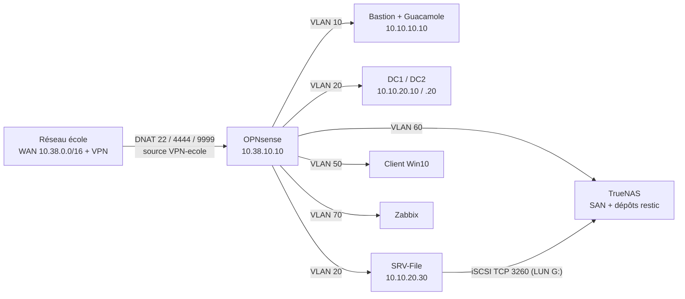

# Infra-lab — Lab NovaTech

> Projet fil rouge du module **Infrastructures avancées 1** (Master Cybersécurité, LiveCampus) :
> concevoir, déployer et gouverner l'infrastructure on-premise d'une PME de 250 collaborateurs
> sur 2 sites, entièrement virtualisée sur le nœud Proxmox VE de l'école.

## L'infrastructure en 30 secondes

- **8 VM**, **7 VLANs** à rôle unique : admin, serveurs, DMZ, stockage, users, sauvegarde, supervision
- **OPNsense** : pare-feu stateful, **deny all par défaut**, portes d'entrée DNAT restreintes au VPN
- **Active Directory redondant** : 2 contrôleurs Windows Server 2022, réplication, GPO, corbeille AD, ADCS, GPO
- **SRV-File** : partages SMB par groupe métier + LUN iSCSI, poste client joint au domaine
- **Bastion Debian** : SSH par clés ed25519, Guacamole, Git, Ansible
- **Sauvegarde en 4 couches** : corbeille AD → wbadmin → **restic chiffré** (SFTP vers TrueNAS, îlot VLAN 60) → vzdump « site 2 »
- **Zabbix** déploié sur un îlot dédié (VLAN 70)

## Architecture

## Contenu du dépôt

| Élément | Contenu |
| --- | --- |
| `Rapport.md` | le dossier complet : adressage, matrice de flux, architecture, procédure de sauvegarde, cartographie SPOF |
| `captures/` | preuves : sorties de commandes, schémas, écrans de configuration |
| `gouvernance/` | RFC, RACI, plan de capacité 36 mois |
| `01-architecture/` … `04-reseau-securite/` | livrables des ateliers, jour par jour |

## Réalisations clés

- **Matrice de flux vérifiable** : deny all par défaut, îlots muets (stockage, sauvegarde, supervision), DMZ verrouillée en tête de règles, validation `nmap`
- **Sauvegarde en profondeur** : restic (chiffrement AES-256, déduplication, rétention 7 quotidiennes / 4 hebdomadaires), automatisé par cron et tâches planifiées, journalisé, durci (fail-fast, ACL par rôles)
- **Incidents réels diagnostiqués et résolus** (MTU imposé, LUN iSCSI, tâche planifiée sous SYSTEM, ACL de clé SSH...) : chaque incident documenté avec symptôme, cause et correctif
- **Pas de SPOF non documenté** : cartographie couche par couche, chaque point de défaillance unique a une parade en place, planifiée ou assumée

## Lecture recommandée

1. `Rapport.md` (le dossier complet, ~20 min)
2. `captures/` au fil de la lecture (chaque section renvoie à ses preuves)
3. `gouvernance/` pour le volet ITIL (RFC de changement, RACI, plan de capacité)

## Notes de sécurité

- **aucun secret dans ce dépôt** : phrases de dépôt restic, `.env` et clés privées sont hors Git (`.gitignore`)
- les accès distants du lab sont restreints au pool VPN de l'école
- toutes les commandes et configurations documentées ont été **exécutées et testées** dans le lab (novembre 2026)

---

Master Cybersécurité LiveCampus, projet « Infrastructures avancées 1 », novembre 2026.*